# CreditDesk — Credit & Renegotiation Proposal Desk on Kubernetes (AWS)

> A full-stack portfolio project by a senior front-end engineer from the Brazilian banking sector: the kind of internal credit tool I've built screens for at large banks — now with the **backend, messaging, cloud and Kubernetes operations** built end to end.

This repository is two things at once:

1. **My portfolio** — a public site with my resume, projects and a "How it's built" page, live at **https://vanilds.github.io**.
2. **CreditDesk** — a working back-office app, opened from the portfolio's **"Try the demo"** button, where bank analysts register customers (individuals and companies), create **credit and debt-renegotiation proposals**, attach documents and move each proposal through an approval workflow. When a proposal is submitted, an **AI agent** drafts a credit opinion (summary, risk flags, suggested installment plan) to support — never replace — the analyst's decision. Every change is audited with LGPD-friendly data masking.

The demo runs on **Kubernetes (k3s) on an AWS EC2 instance**, with documents and backups in **Amazon S3**.

---

## 1. System overview

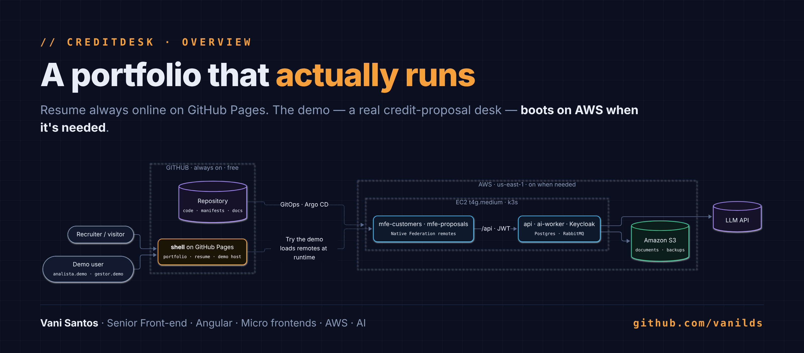

<details><summary>Mermaid source</summary>

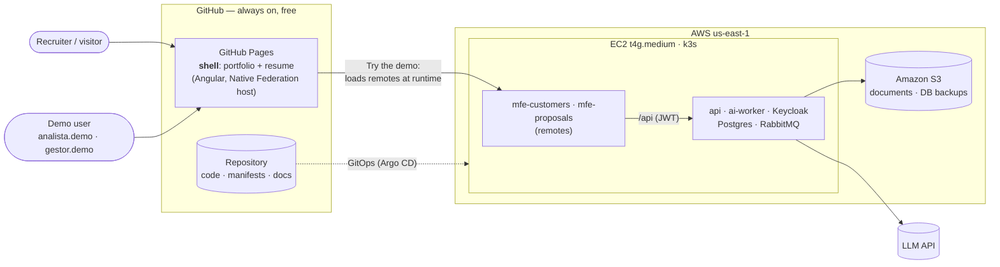

</details>

**Design decision — graceful degradation.** The portfolio and resume are static and live on GitHub Pages, so they never go down and cost nothing. The demo's micro frontends are loaded at runtime from the EC2 cluster. When the instance is stopped (to save credits), the shell catches the failed remote load and shows *"Demo offline — watch the 2-minute video"* instead of breaking. Same fallback pattern I use for micro frontends in banking apps.

---

## 2. AWS infrastructure

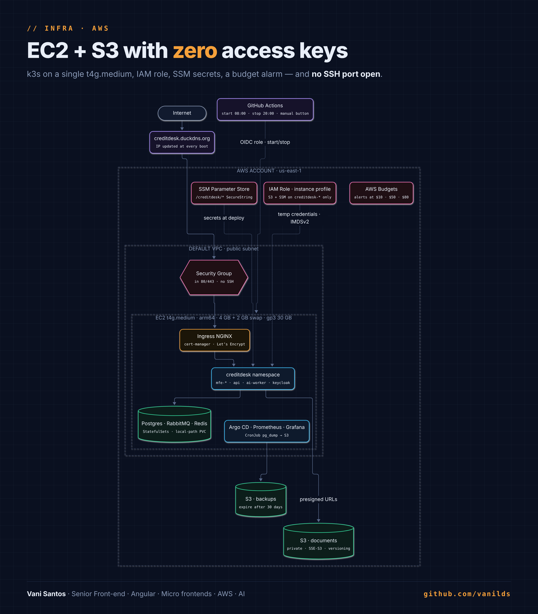

<details><summary>Mermaid source</summary>

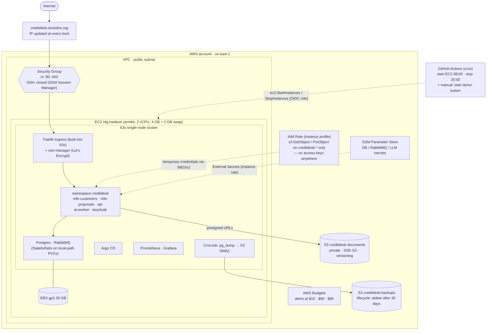

</details>

**Cost plan.** On-demand t4g.medium is about $0.034/hour. Running it only ~10 hours on weekdays (plus on demand before interviews) keeps the whole project at roughly **$10/month**, including EBS, the public IP and S3 — so the $100 credit lasts for many months. There's deliberately **no Elastic IP**: AWS bills every public IPv4 address, and an Elastic IP keeps billing while the instance is stopped. Instead, a boot script updates the DuckDNS record with the new IP. A Budgets alert fires long before anything surprising happens.

**Security choices worth discussing in an interview:**
- No SSH port open — shell access only through **SSM Session Manager**.
- No AWS access keys in code, pods or GitHub — the EC2 uses an **IAM instance profile**, and GitHub Actions assumes a role through **OIDC**.
- Documents are never public: the API issues **short-lived presigned URLs**.
- IMDSv2 required, with hop limit 2 so pods can reach it.

---

## 3. Inside the cluster

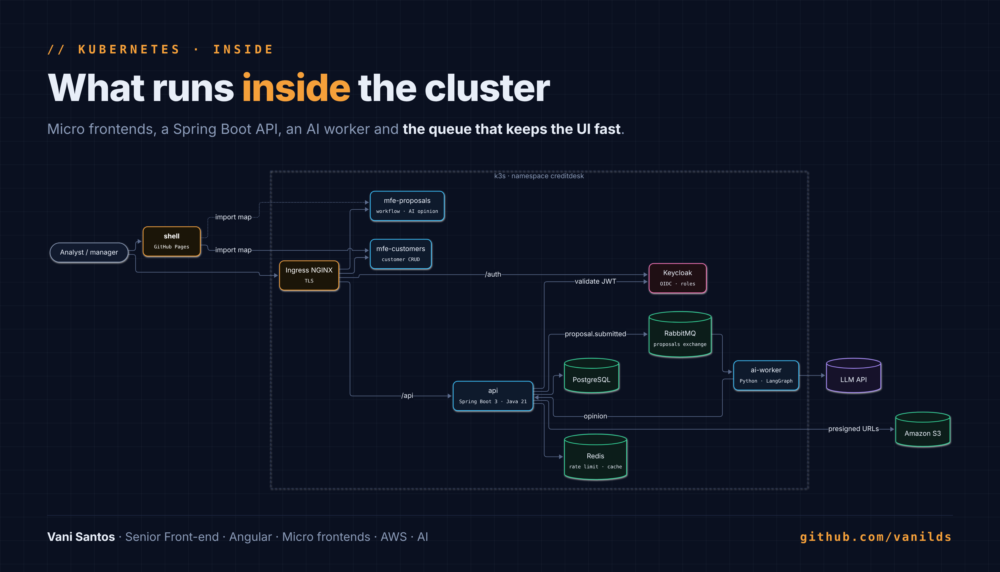

<details><summary>Mermaid source</summary>

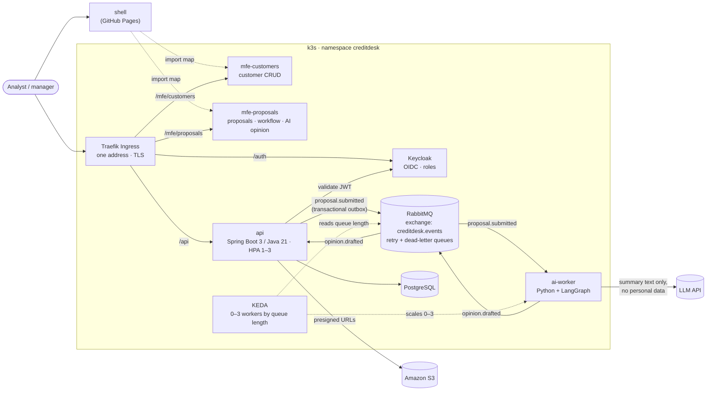

</details>

---

## 4. Domain (the CRUD)

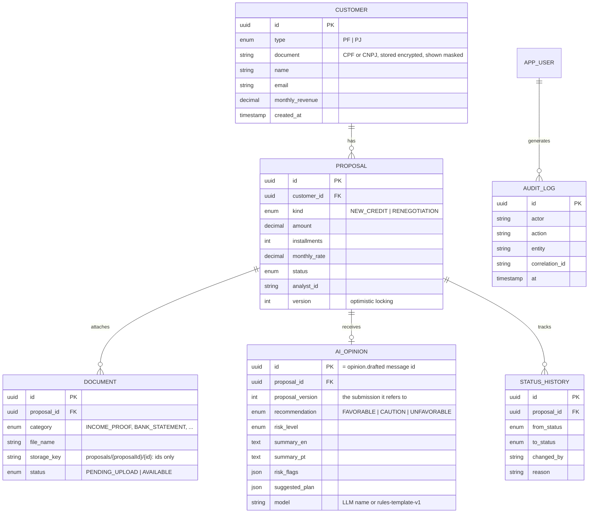

### Proposal workflow

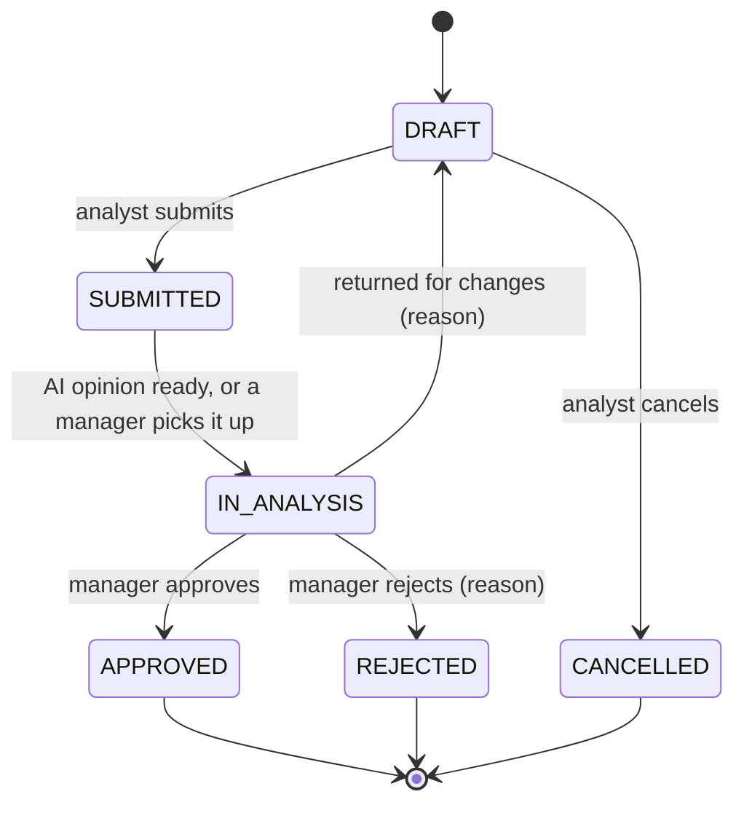

### Roles

| Role | Can do |
|---|---|
| `ANALYST` | CRUD customers, create/edit/submit/cancel **own** proposals, upload documents |
| `MANAGER` | Everything an analyst can, plus start analysis/approve/reject/return proposals **created by someone else** (four-eyes principle) |
| `AUDITOR` | Read-only access to customers, proposals and the audit trail; can reveal a full CPF by giving a reason, which is itself audited |

Every change writes, in the same database transaction, a line to the proposal's status timeline (read by the analyst) and to the append-only audit log (read by managers and auditors), with the user, the request's `X-Correlation-Id` and personal data masked. CPF/CNPJ are stored encrypted (AES-256-GCM) with an HMAC for search; the database never holds them in clear.

---

## 5. Key flows

### Submitting a proposal

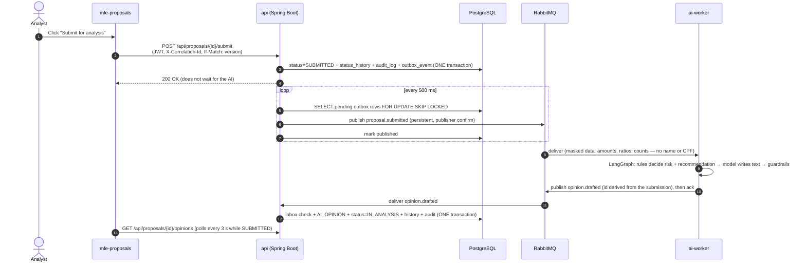

**What happens when something fails** (integration tests cover retries, dead letters, duplicates and late opinions; the broker outage was drilled by stopping RabbitMQ in `docker compose`):

| Failure | What the system does |
|---|---|
| RabbitMQ is down when the analyst submits | The submit still succeeds: the event waits in `outbox_event` and goes out when the broker is back (`creditdesk_outbox_pending` shows the backlog). |
| The API crashes after publishing, before marking the row | The event is published again. Consumers deduplicate on the message id (inbox table), so nothing happens twice. |
| The worker crashes mid-opinion | The message was not acknowledged, so RabbitMQ delivers it again. The opinion id is derived from the submission, so a second copy is recognized. |
| A message keeps failing | Rejected into `<queue>.retry`, back after a delay, up to N attempts, then parked in `<queue>.dlq` with the reason. Unreadable messages skip the retries. |
| The LLM is down, slow or answers something wrong | The worker falls back to its rules template. The business never depends on the model. |
| The worker is down for a long time | A manager can still use **start analysis**; a late opinion is stored, marked against its version, and never moves the proposal back. |

### Uploading a document (presigned URL)

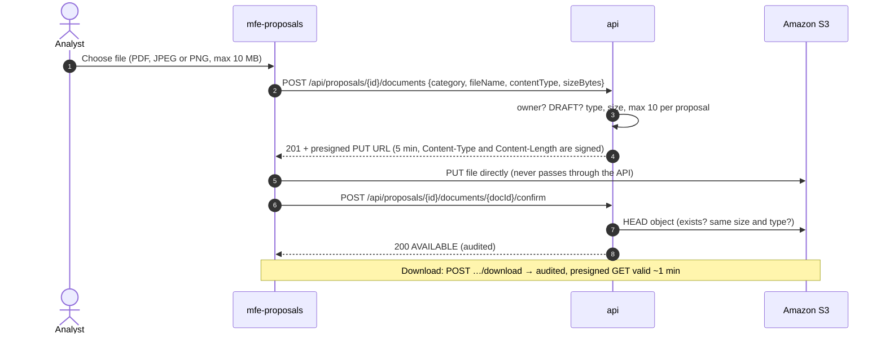

### Delivery pipeline

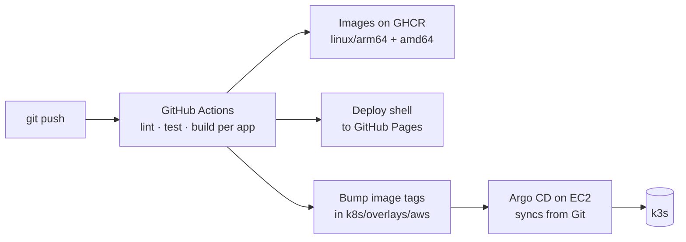

---

## 6. API

| Method | Path | Notes |
|---|---|---|
| `GET` | `/api/customers?document=&name=&page=&size=` | Paginated search, document returned masked |
| `POST` | `/api/customers` | CPF/CNPJ validation (check digits), duplicate check |
| `GET` / `PUT` / `DELETE` | `/api/customers/{id}` | `ETag` on read, `If-Match` on write; soft delete blocked while there are open proposals |
| `POST` | `/api/customers/{id}/document/reveal` | `AUDITOR` only, reason required, audited |
| `GET` | `/api/proposals?status=&from=&to=&customerId=&mine=` | Max 90-day window, 20/50/100 page sizes |
| `POST` | `/api/proposals` | Creates a `DRAFT` owned by the caller |
| `PUT` | `/api/proposals/{id}` | Owner only, only in `DRAFT`; `If-Match` |
| `POST` | `/api/proposals/{id}/submit` · `/cancel` · `/start-analysis` · `/approve` · `/reject` · `/return` | Workflow commands: role, owner and four-eyes checks; `If-Match` |
| `GET` | `/api/proposals/{id}/history` | Status timeline with who and why |
| `GET` | `/api/proposals/{id}/opinions` | AI opinions, newest first; `current` marks the one for the latest submission |
| `GET` / `POST` | `/api/proposals/{id}/documents` | List / start an upload (owner, `DRAFT`): returns a presigned S3 `PUT` |
| `POST` | `/api/proposals/{id}/documents/{docId}/confirm` · `/download` | Check the object in S3 / get an audited, short-lived download link |
| `GET` | `/api/audit?entityType=&entityId=&actorId=&action=&from=&to=` | `MANAGER` / `AUDITOR` only |

Every `/api` call needs a Keycloak access token (`Authorization: Bearer …`). Errors follow RFC 9457 (`application/problem+json`), including 401, 403, 412 and 428. The contract lives in `api/openapi.yaml` and the front-ends generate their clients from it.

How to run it, the demo users and the design decisions are in [`api/README.md`](api/README.md).

---

## 7. Running it on Kubernetes (kind)

Open a codespace on `main` and run:

```bash
k8s/local/up.sh      # cluster + Traefik/KEDA/metrics-server + images + deploy, waits until ready (~10 min the first time)
k8s/local/smoke.sh   # end-to-end check through the Ingress
k8s/local/down.sh    # throw the cluster away
```

Port **8088** opens the whole demo (`/` shell, `/demo`, `/api`, `/auth`, `/mfe/*`). The 8 GB codespace fits either `docker compose` **or** the cluster, not both. The same `up.sh` + `smoke.sh` run on every pull request in `.github/workflows/k8s.yml`.

| Decision | Why |
|---|---|
| **One address, split by path** (`/api`, `/auth`, `/mfe/*`, `/creditdesk-documents`, `/`) | Same origin for the browser: no CORS between the apps, one place for TLS. Paths are never rewritten — presigned S3 URLs are signed over the exact path and `Host`, so a rewrite would turn every upload into a 403. |
| **One `PUBLIC_URL`, everything derived** (token issuer, Keycloak `--hostname`, CORS, presigned URLs, login redirect) | The Codespaces URL is different for every codespace; one value set by `up.sh` keeps them consistent. Keycloak fills the realm's `${CREDITDESK_PUBLIC_URL}` placeholder at import. |
| **Traefik**, standard Ingress API only | Ingress NGINX was retired by the Kubernetes project in March 2026; Traefik ships with k3s, so kind and EC2 run the same controller. |
| **Three probes with different questions** | *startup*: may take 3 min (Flyway + Spring on 2 vCPUs) without being killed; *readiness*: may receive traffic; *liveness*: process not stuck — it never checks Postgres or RabbitMQ, because restarting every pod during a database outage only adds a restart storm. |
| **Memory limits, no CPU limit on the JVMs** | CPU limits throttle the JVM even on an idle node; the memory limit protects the node and sizes the heap (`MaxRAMPercentage`). |
| **HPA on CPU for the API (1–3), KEDA on queue length for the worker (0–3)** | API requests are short and CPU-bound. The worker mostly waits (broker, model), so CPU says nothing — the queue length says exactly how much work is waiting, and an empty queue means zero pods. Messages wait safely in the durable queue while the worker is at zero. |
| **No `replicas` in Deployments the autoscalers own** | Otherwise every `kubectl apply` / Argo CD sync would reset what the HPA chose. |
| **Graceful shutdown**: `preStop` sleep → SIGTERM → Spring finishes in-flight requests | The Ingress needs a few seconds to stop routing to a terminating pod; without the pause, rollouts drop requests. `maxUnavailable: 0` keeps capacity during rollouts. |
| **Non-root, read-only root filesystem, all capabilities dropped** | Numeric uids (`10001`, nginx `101`) so `runAsNonRoot` can verify them; only `/tmp` is writable (an `emptyDir`). |
| **Kustomize generators for config, secrets and the realm** | Content hash in the name: change a value and the pods that use it roll automatically. Secrets are random per environment (`up.sh`, git-ignored); on AWS they come from SSM through External Secrets. |
| **Images loaded into kind, no registry** | `kind load docker-image` + `imagePullPolicy: IfNotPresent`: nothing to publish to try the system locally. On AWS: multi-arch images from GHCR (next section). |

---

## 8. Running it on AWS (k3s + Argo CD)

Merging to `main` is the deployment: `.github/workflows/images.yml` builds the five images for amd64 and arm64, pushes them to GHCR as `sha-<commit>` and commits that tag to `k8s/overlays/aws`. Argo CD, running in the cluster, sees the commit and rolls the Deployments. Step-by-step setup and operations: [docs/aws.md](docs/aws.md).

| Decision | Why |
|---|---|
| **GitOps with Argo CD, app of apps** | The EC2 bootstrap installs only k3s and Argo CD and applies one `root` Application; everything else (cert-manager, External Secrets, KEDA, issuers, CreditDesk) is a file in `k8s/argocd/apps`. Manual changes are reverted (`selfHeal`); the whole server can be recreated from git in ~15 minutes. |
| **CI pushes images, Git deploys them** | GitHub Actions never touches the cluster (no kubeconfig, no inbound port). A release is a commit, so the history of what ran in production is `git log k8s/overlays/aws`, and a rollback is `git revert`. |
| **One tag for all five images** | A release is a set of images tested together. Unchanged images rebuild from cache in seconds. |
| **Multi-arch without slow emulation** | Java and Angular compile on the runner's own CPU (`--platform=$BUILDPLATFORM`); only the final layers are assembled per architecture. The same images run in Codespaces (amd64) and on the t4g instance (arm64). |
| **Secrets: SSM Parameter Store → External Secrets** | Values are generated once in CloudShell and stored KMS-encrypted; External Secrets copies them into the `creditdesk-secrets` Secret with the instance role. Nothing secret in git, in CI or in the bootstrap script. Never overwritten: the CPF/CNPJ encryption key cannot change without a migration. |
| **Real S3 with the instance role** | The API gets no endpoint and no keys: the AWS SDK takes temporary credentials from the metadata service (IMDSv2, hop limit 2). Presigned URLs point straight at S3; the bucket's CORS allows only the two front-end origins. |
| **TLS: cert-manager + Let's Encrypt (HTTP-01)** | Free, renewed automatically. The http → https redirect is a Traefik middleware on the app's Ingress only, so the ACME challenge on port 80 keeps working. |
| **Fits on one 4 GB node** | Argo CD without Dex, notifications and ApplicationSet; External Secrets and KEDA without their validating webhooks (manifests are validated in CI instead); smaller memory requests for the apps; 2 GB swap as the safety net. |
| **Server found by tag, not by id** | The start/stop workflow and the IAM policy use the `Project=creditdesk` tag, so recreating the instance changes nothing else. |

---

## 9. Tech stack

| Layer | Choice | Why it's here |
|---|---|---|
| Portfolio + shell | Angular 22, Native Federation host, signals, GitHub Pages | Always-on showcase; loads the demo remotes only when the demo is opened, with an offline fallback |
| Micro frontends | `mfe-customers`, `mfe-proposals` (Angular, standalone + signals), shared `@creditdesk/shared` singleton | The architecture I use daily at the bank, built from scratch; types generated from `api/openapi.yaml` |
| Auth | Keycloak (OIDC, PKCE, realm roles) | Same flow as corporate SSO / Entra ID |
| API | Java 21, Spring Boot 3, Spring Security, Spring Data JPA, Flyway, Bean Validation, springdoc, AWS SDK v2 | Layered design, validation, migrations, contracts, optimistic locking, transactional outbox |
| Async | RabbitMQ (topic exchange, retry + dead-letter queues) | AI opinion is slow; the UI must not wait for it |
| AI | Python 3.12, LangGraph | An agent that assists a human decision, using masked data only |
| Data | PostgreSQL 16 | Relational model; login rate limiting is Keycloak's brute-force detection, so no extra cache is needed |
| Cloud | AWS EC2 (t4g), S3, IAM roles, SSM, Budgets | Real AWS, least-privilege, no static keys |
| Orchestration | Kubernetes (kind locally, k3s on EC2), Kustomize, Traefik Ingress, startup/readiness/liveness probes, requests/limits, HPA (CPU) for the API, KEDA (queue length, scale to zero) for the worker | The core learning goal; the same manifests run in Codespaces, in CI and on EC2 |
| CI/CD | GitHub Actions (OIDC to AWS), GHCR multi-arch images, Argo CD | Push-to-deploy, GitOps |
| Observability | Micrometer, OpenTelemetry, Prometheus, Grafana | Follow one `correlation-id` from the browser to the worker |
| Dev environment | GitHub Codespaces + kind | Everything runs in the browser — no powerful laptop needed |

---

## 10. Repository layout

```
vanilds.github.io/
├── web/                  # Angular workspace (README inside)
│   └── projects/
│       ├── shell/        # portfolio + resume + demo host → GitHub Pages
│       ├── mfe-customers/# remote → EC2
│       ├── mfe-proposals/# remote → EC2
│       └── shared/       # auth, API client (generated types), i18n, UI bits — shared as a singleton
├── api/                  # Spring Boot service + openapi.yaml
├── ai-worker/            # Python LangGraph worker (README inside)
├── k8s/
│   ├── base/             # Kustomize base manifests
│   ├── local/            # up.sh · smoke.sh · down.sh for the kind cluster
│   ├── overlays/
│   │   ├── local/        # kind in Codespaces and CI (SeaweedFS stands in for S3)
│   │   └── aws/          # k3s on EC2 (GHCR images, real S3, TLS, secrets from SSM, smaller limits)
│   ├── argocd/           # root Application + one Application per add-on / app (GitOps)
│   └── platform/         # cluster-wide objects: Let's Encrypt issuers
├── infra/aws/            # AWS setup, secrets, EC2 bootstrap (k3s + Argo CD), IAM policies (CloudShell scripts)
├── docs/                 # aws.md runbook · diagrams/ (branded PNGs + their sources)
├── .devcontainer/        # one-click Codespaces environment
├── compose.yaml          # local stack: docker compose up --build
└── .github/workflows/
```

---

## 11. Roadmap

- [x] **Phase 1 — CRUD backend**: customers and proposals in Spring Boot, Postgres + Flyway, CPF/CNPJ validation, pagination and filters, RFC 9457 errors, OpenAPI, Testcontainers, `docker compose up` in Codespaces.
- [x] **Phase 2 — Security & workflow**: Keycloak realm with `ANALYST`/`MANAGER`/`AUDITOR`, JWT resource server, workflow with ownership and four-eyes, optimistic locking with `ETag`/`If-Match`, append-only audit log, CPF/CNPJ encrypted at rest, data masking.
- [x] **Phase 3 — Portfolio & micro frontends**: shell with portfolio + resume on GitHub Pages, `mfe-customers` + `mfe-proposals` with Native Federation, offline fallback, clients generated from OpenAPI.
- [x] **Phase 4 — Events, AI & S3**: transactional outbox → RabbitMQ with publisher confirms, retry and dead-letter queues, idempotent consumers on both sides, LangGraph worker (rules decide, the model only writes, guardrails check), presigned S3 uploads and audited downloads.
- [x] **Phase 5 — Kubernetes locally**: kind in Codespaces and CI, one Traefik Ingress for every app (presigned S3 URLs included), startup/readiness/liveness probes, requests/limits, non-root read-only pods, HPA for the API, KEDA scaling the worker from zero on queue length, end-to-end smoke test in CI.
- [ ] **Phase 6 — AWS**: multi-arch images on GHCR, GitOps with Argo CD (app of apps), k3s on EC2 with Traefik + Let's Encrypt, secrets from SSM through External Secrets, real S3 with the instance role, recreate-from-git bootstrap, start/stop by tag.
- [ ] **Phase 7 — Operations**: Prometheus/Grafana dashboards, tracing by correlation-id, daily backups to S3 and a tested restore, incident drills written up in `docs/`.

---

## Author

**Vani Santos** — Senior Front-end Engineer (Angular, micro frontends, banking) growing into backend, cloud and applied AI.

> All customer data in this repo is synthetic. CPF/CNPJ values are generated test numbers.
